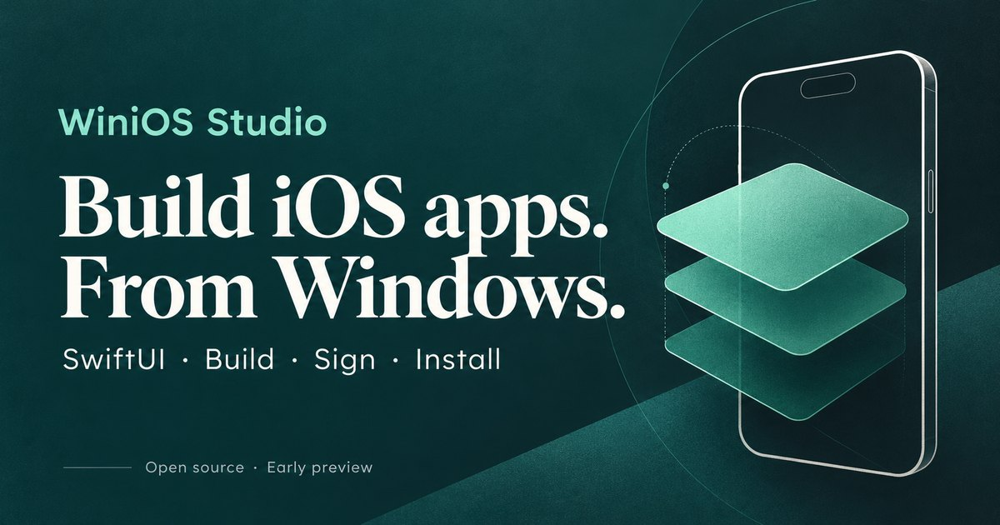

<div align="center">

<a href="https://aquirozai.github.io/winios.studio/"></a>

# WiniOS Studio

**Tus apps SwiftUI — compiladas, firmadas, instaladas y verificadas en tu iPhone. Desde Windows, sin Mac.**

[](https://github.com/AQuirozAI/winios.studio/actions/workflows/ci.yml)
[](https://github.com/AQuirozAI/winios.studio/releases)
[](LICENSE)
[](#requisitos)
[](https://github.com/xtool-org/xtool)
[](https://v2.tauri.app)
[](CONTRIBUTING.md)

[English](README.md) · Español

[Página web](https://aquirozai.github.io/winios.studio/) · [Descargar](https://github.com/AQuirozAI/winios.studio/releases) · [Reportar un problema](https://github.com/AQuirozAI/winios.studio/issues)

> [!WARNING]
> **Pre-release temprano.** El ciclo completo está probado en un equipo (Windows 11 + WSL2 + iPhone con iOS 27). Revisa las [preguntas frecuentes](#preguntas-frecuentes) antes de instalar.

</div>

<!-- TODO(lanzamiento): 2–3 capturas reales (asistente de un clic · fases del pipeline · app en el iPhone) -->

WiniOS Studio es un estudio de escritorio para desarrollo **iOS nativo en Windows**. Un asistente de un clic prepara todo lo que normalmente requiere una Mac — el toolchain Swift, la firma y el dispositivo — y un pipeline integrado compila, firma, instala y **verifica** tu app en tu iPhone, con evidencia en cada fase.

Bajo el capó usa [xtool](https://github.com/xtool-org/xtool) (MIT) dentro de una distribución WSL dedicada a la app: sin tocar tus otras instalaciones, sin backend y con tus credenciales solo en tu equipo.

## Características

- 🧙 **Asistente de un clic** — prepara WSL, Swift, xtool, SDK, Apple ID y el puente del iPhone; idempotente y auto-reparable
- 🧱 **Proyectos SwiftUI + SwiftPM** — plantilla con `Package.swift`, `xtool.yml` y commit base de `git init`, lista para construir
- 🚀 **«Ejecutar en mi iPhone»** — un pipeline visible: *compilar → firmar → empaquetar → conectar → instalar → verificar*
- 🔎 **Estados que no mienten** — *instalada ≠ abierta*; cada error explicado con su siguiente acción (2FA, certificados, cable, SDK)
- 🖥️ **Abrir en VS Code** — servidor remoto en la distro con la extensión oficial de Swift y SourceKit-LSP listos
- 🌐 **Interfaz EN/ES**

## Requisitos

| | |
| --- | --- |
| 💻 Windows 10/11 (x64) | permisos de administrador una sola vez (UAC) |
| 🍎 Apple ID | la gratuita sirve para compilar y probar en tu propio iPhone |
| 📦 Xcode 27 `.xip` | se pide una vez dentro de la app (Apple exige que lo descargues con tu cuenta) |
| 📱 iPhone + cable USB | desbloqueado, con *Confía en este equipo* y **Modo Desarrollador** |

## Instalación

Descarga el instalador de la última [release](https://github.com/AQuirozAI/winios.studio/releases) y ejecútalo:

1. El asistente configura todo el entorno (acepta los permisos que Windows pida)
2. Arrastra tu `Xcode.xip` cuando te lo pida e inicia sesión con tu Apple ID
3. Conecta tu iPhone y pulsa **Ejecutar en mi iPhone**

### Desde el código fuente

```powershell
powershell -ExecutionPolicy Bypass -File .\scripts\build-windows.ps1
```

### Solo CLI

```powershell
powershell -ExecutionPolicy Bypass -File .\scripts\install-windows.ps1
```

```bash
./scripts/winiz.sh status          # estado del entorno y del iPhone
./scripts/winiz.sh new MiApp       # crea un proyecto SwiftUI
./scripts/winiz.sh run MiApp       # compila + firma + instala en el iPhone
```

## Preguntas frecuentes

**¿Necesito la cuenta de $99/año de Apple?**
No — un **Apple ID gratuito** basta para compilar y ejecutar en *tu propio iPhone*. Las cuentas gratuitas tienen expiración de firma a los 7 días y límite de 2 certificados (reglas de Apple; la app responde la revocación del certificado viejo por ti). La App Store sí requiere el programa pago — fuera del alcance de la v1.

**¿Es legal sin Mac?**
El acuerdo de licencia de los SDK de Apple prohíbe instalarlos en hardware no-Apple. WiniOS no redistribuye nada de Apple: descargas tu propio `Xcode.xip` con tu cuenta y firmas con tu Apple ID — el mismo enfoque de xtool. Úsalo bajo tu propio riesgo, sobre todo con Apple IDs de empresa. *(«Apple», «iPhone», «Xcode» y «SwiftUI» son marcas de Apple Inc.; este proyecto no está afiliado ni respaldado por Apple.)*

**¿Funciona con proyectos Xcode existentes (`.xcodeproj`)?**
Aún no — los proyectos se crean con la plantilla SwiftPM/SwiftUI del motor. La importación está en la hoja de ruta.

**¿Hay simulador o hot reload?**
No. El simulador y las Previews de SwiftUI solo corren en macOS. El ciclo aquí es: editas → ejecutas → la app se instala y verifica en tu iPhone (8.3 s el primer build, 0.8 s incremental). La apertura automática puede fallar en iOS 27; la app te lo avisa y tú la abres en el teléfono.

**¿Puedo editar en VS Code?**
Sí — con un clic la app configura el servidor remoto de VS Code dentro de la distro, con la extensión de Swift y el build server listos.

## Arquitectura

```
Tauri 2 (motor Rust) ──scripts por stdin──▶ distro WSL aislada "WinIOS"
                                              │  Swift · xtool · proyectos
                                              ▼
                   Apple Mobile Device Service (Windows, tcp/27015)
                                              │  portproxy → gateway WSL
                                              ▼
                                          📱 iPhone (USB, se queda en Windows)
```

Cada operación es un comando del motor con validación: la UI nunca genera comandos libres, los secretos nunca salen de tu equipo y el transporte se resuelve dinámicamente (la vía estándar `usbipd` falla en *Installing* con `AFCClient.Error.muxError` — resuelto aquí con el servicio de Apple Devices y un puente TCP; [cómo funciona](docs/research/2026-10-19-transport-iphone.md)).

## Hoja de ruta

1. **v0.3 — IA integrada (Codex)**: pedir cambios, revisar diffs y *Build & Fix*
2. **Preview real del iPhone conectado**
3. **Pipeline TestFlight** / distribución
4. **Importación de `.xcodeproj`**
5. **Windows sin WSL**

## Contribuir

Los issues concretos y reproducibles son la mejor entrada — antes de algo grande, abre uno y hablemos. Si tu mejora toca el *toolchain* (transporte, firma, SDK), valora primero contribuir aguas arriba a [xtool](https://github.com/xtool-org/xtool). Detalles en [CONTRIBUTING.md](CONTRIBUTING.md); reportes de seguridad en [SECURITY.md](SECURITY.md).

## Documentación

- [CHANGELOG.md](CHANGELOG.md) — historial de versiones
- [Investigación y especificaciones](docs/) — investigación de mercado, entorno y diseño del producto
- [DESIGN.md](DESIGN.md) — sistema de diseño de la UI
- [README.md](README.md) — versión en inglés

## Licencia

[Apache-2.0](LICENSE) · Copyright © 2026 AQuirozAI. Este proyecto no redistribuye software de Apple; contexto legal en las [preguntas frecuentes](#preguntas-frecuentes).
