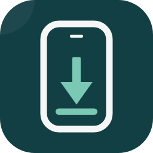

<div align="center">



# WiniOS Studio

**Tus apps SwiftUI compiladas, instaladas y verificadas en tu iPhone — desde Windows, sin Mac.**

[](https://github.com/AQuirozAI/winios.studio/actions/workflows/ci.yml)
[](https://github.com/AQuirozAI/winios.studio/releases)
[](LICENSE)
[](#requisitos)
[](https://github.com/xtool-org/xtool)
[](https://v2.tauri.app)
[](CONTRIBUTING.md)

> [!WARNING]
> **Pre-release temprano.** El ciclo completo está probado en un equipo (Windows 11 + WSL2 + iPhone con iOS 27). Consulta los [límites](#preguntas-frecuentes) antes de instalar.

</div>

<!-- TODO(lanzamiento): 2–3 screenshots reales (asistente de un clic · fases del pipeline · app en el iPhone) -->

WiniOS Studio es un estudio de escritorio para desarrollo **iOS nativo** en Windows. Un asistente de un clic configura todo lo que normalmente requiere una Mac — el toolchain Swift, la firma y el dispositivo — y un pipeline integrado compila, firma, instala y **verifica** tu app en tu iPhone con evidencia en cada fase.

Bajo el capó usa [xtool](https://github.com/xtool-org/xtool) (MIT) sobre una distribución WSL aislada dedicada a la app: sin tocar tus otras instalaciones, sin backend, y con tus credenciales solo en tu equipo.

## Características

- 🧙 **Asistente de un clic** — prepara WSL, Swift, xtool, SDK, Apple ID y el puente del iPhone; idempotente y reparable
- 🧱 **Proyectos SwiftUI + SwiftPM** — plantilla con `Package.swift`, `xtool.yml` y `git init` lista para construir
- 🚀 **«Ejecutar en mi iPhone»** — un pipeline visible: *compilar → firmar → empaquetar → conectar → instalar → verificar*
- 🔎 **Estados que no mienten** — *instalada ≠ abierta*; errores explicados con la acción siguiente (2FA, certificados, cable, SDK)
- 🖥️ **Abrir en VS Code** — servidor remoto en la distro con la extensión oficial de Swift y SourceKit-LSP listos
- 🌐 **Interfaz EN/ES**

## Requisitos

| | |
| --- | --- |
| 💻 Windows 10/11 (x64) | permisos de administrador una sola vez |
| 🍎 Apple ID | gratuita sirve para instalar y probar en tu iPhone |
| 📦 Xcode 27 `.xip` | se pide una vez en la app (Apple exige que lo descargues con tu cuenta) |
| 📱 iPhone + cable | desbloqueado, con *Confiar en este equipo* y **Modo Desarrollador** |

## Instalación

Descarga el instalador de la última [release](https://github.com/AQuirozAI/winios.studio/releases) y ejecútalo:

1. El asistente configura el entorno completo (acepta los permisos que Windows pida)
2. Arrastra tu `Xcode.xip` cuando te lo pida e inicia sesión con tu Apple ID
3. Conecta tu iPhone y pulsa **Ejecutar en mi iPhone**

### Desde el código fuente

```powershell
powershell -ExecutionPolicy Bypass -File .\scripts\build-windows.ps1
```

### Solo CLI

```powershell
powershell -ExecutionPolicy Bypass -File .\scripts\install-windows.ps1
```

```bash
./scripts/winiz.sh status          # estado del entorno y del iPhone
./scripts/winiz.sh new MiApp       # crea un proyecto SwiftUI
./scripts/winiz.sh run MiApp       # compila + firma + instala en el iPhone
```

## Preguntas frecuentes

**¿Necesito la cuenta de $99/año de Apple?**
No para desarrollar y probar en tu iPhone: con un Apple ID gratuito basta. Con perfiles gratuitos la firma expira a los 7 días y hay un límite de 2 certificados de desarrollo (la app responde la revocación del certificado viejo por ti). Sí necesitas el programa pago para publicar en la App Store — fuera del alcance de la v1.

**¿Es legal sin Mac?**
El acuerdo de licencia de los SDK de Apple prohíbe instalarlos en hardware no-Apple. WiniOS no redistribuye nada de Apple: tú descargas tu `Xcode.xip` con tu propia cuenta y firmas con tu Apple ID — el mismo enfoque de xtool. Úsalo con tu cuenta bajo tu propio riesgo; tenlo en cuenta si usas una Apple ID de empresa. *(«Apple», «iPhone», «Xcode» y «SwiftUI» son marcas de Apple Inc. — proyecto no afiliado.)*

**¿Funciona con proyectos Xcode existentes (`.xcodeproj`)?**
Aún no — los proyectos se crean con la plantilla SwiftPM/SwiftUI del motor. La importación está en la hoja de ruta.

**¿Hay simulador o hot reload?**
No. El simulador y las Previews de SwiftUI corren solo en macOS. El ciclo aquí es: editas → ejecutas → la app se instala y verifica en tu iPhone (8.3 s el primer build, 0.8 s incremental). La apertura automática puede fallar en iOS 27; en ese caso la app te lo dice y la abres en tu teléfono.

**¿Puedo editar en VS Code?**
Sí — con un clic: la app configura el servidor remoto de VS Code dentro de la distro con la extensión de Swift y el build server listos.

## Arquitectura

```
Tauri 2 (motor Rust) ──scripts por stdin──▶ distro WSL aislada "WinIOS"
                                              │  Swift · xtool · proyectos
                                              ▼
                   Apple Mobile Device Service (Windows, tcp/27015)
                                              │  portproxy → gateway WSL
                                              ▼
                                          📱 iPhone (USB, en Windows)
```

Cada operación es un comando del motor con validación: la interfaz nunca genera comandos libres, los secretos nunca salen de tu equipo y el transporte se calcula dinámicamente (el estándar `usbipd` falla la instalación con `AFCClient.Error.muxError`; resuelto con el servicio de Apple Devices + puente TCP — [detalle](docs/research/2026-10-19-transport-iphone.md)).

## Hoja de ruta

1. **v0.3 — IA integrada (Codex)**: pedir cambios con IA, revisar diffs y *Build & Fix*
2. **Preview real del iPhone conectado**
3. **Pipeline TestFlight** / distribución
4. **Importación de `.xcodeproj`**
5. **Windows sin WSL**

## Contribuir

Los issues concretos son la mejor entrada — antes de algo grande, abre uno y hablemos. Si tu mejora toca el *toolchain* (transporte, firma, SDK), primero valora contribuir aguas arriba a [xtool](https://github.com/xtool-org/xtool). Más detalles en [CONTRIBUTING.md](CONTRIBUTING.md).

Reportes de seguridad → [SECURITY.md](SECURITY.md).

## Documentación

- [CHANGELOG.md](CHANGELOG.md) — historial de versiones
- [Investigación y especificaciones](docs/) — research de mercado, entorno y diseño del producto
- [DESIGN.md](DESIGN.md) — sistema de diseño de la interfaz

## Licencia

[Apache-2.0](LICENSE) · Copyright © 2026 AQuirozAI. Este proyecto no redistribuye software de Apple; consulta el [aviso legal](#preguntas-frecuentes).
